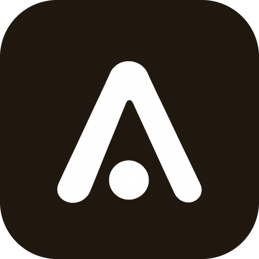

# Adset plugin for Claude



Run [Adset](https://www.adset.agency) from Claude in plain language. Adset launches and manages ads on Meta (Facebook and Instagram), Google Ads (Demand Gen) and AppLovin from your ClickUp, Notion or Google Sheets tasks. With this plugin you can:

- launch Launcher tasks on Meta, Google and AppLovin;
- run Media Buying and Platform Ops rules and decide on their recommendations;
- make spot changes to your ads: landing pages, budgets, status, names, targeting, duplicates and text variants.

Claude asks when something is missing, shows a summary, and changes nothing without your explicit "yes".

## What's inside

| Part | What it does |
|---|---|
| `adset` connector (`.mcp.json`) | Connects Claude to Adset's remote MCP server at `https://www.adset.agency/mcp`. You sign in with your Adset account (OAuth), and Claude acts with your Adset permissions. |
| Skill `adset:launcher` | Launching tasks: check, questions, summary, confirmation, result per task |
| Skill `adset:media-buying` | Running Media Buying rules and deciding on their recommendations, one at a time or several together |
| Skill `adset:platform-ops` | Platform Ops rules: list, create, change, run, recommendations |
| Skill `adset:ads-management` | Spot operations (landing pages, duplicates, variants, budgets, status, targeting) and requests that combine the other skills |

The plugin contains only instructions (skills) and the connector's address: it runs no code on your computer.

## Requirements

- An Adset account that belongs to at least one workspace, with the ad platforms and task tools you want to use already connected in Adset.
- On claude.ai, "Code execution and file creation" turned on (Settings → Capabilities): skills need it.

## Install

**claude.ai:** find "Adset" in the plugin directory and install it. Then, in the plugin's Connectors tab, select Connect, sign in to Adset and choose "Read only" or "Read and change".

**Claude Code:**

```bash
claude plugin marketplace add giovanni-adset/adset-plugin
claude plugin install adset@adset
```

On first use Claude Code opens Adset's sign-in page.

## Example requests

- "Launch the ready tasks on Meta in the Scaling CBO campaign, budget 150 per day."
- "Run the Meta Media Buying rule and show me every recommendation." Then: "Apply the first and the third, set the second to 250, skip the rest."
- "Create a Platform Ops rule that duplicates ads with spend above 100 and Triple Whale NC ROAS above 0.5."
- "Find the active ads with the old domain in the URL and change them to https://new-landing.com."

You can write in any language: Claude answers in yours.

## Rules the plugin always follows

- Before any change Claude shows the exact list of objects and values, and asks for confirmation.
- Everything created starts paused. Claude turns nothing on unless you ask.
- Every change is recorded in Adset's Logs as "Name (via Claude)" and can almost always be undone.
- Claude never sees passwords or the access tokens of the services connected to Adset.

## Data and privacy

The plugin sends data only to Adset's connector at `https://www.adset.agency/mcp`. Through it, Claude reads and, with "Read and change", modifies the data you can access in Adset; the tool results are returned to Claude to answer you. Adset stores your authorization and a record of every change made through Claude in its Logs. See the [Privacy Policy](https://www.adset.agency/privacy#claude) and the [documentation](https://www.adset.agency/docs/claude).

## Support

Write to giovanni@adset.agency, or see the [documentation](https://www.adset.agency/docs/claude#support).

## License

[MIT](LICENSE)
